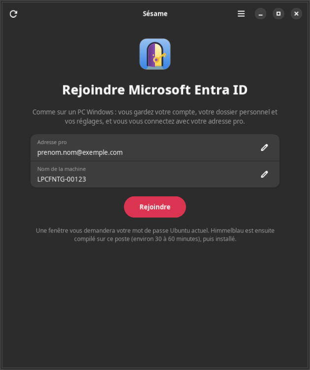

# Sésame

**Site : [mawena.github.io/sesame](https://mawena.github.io/sesame/)** — dépôt APT signé, mises à jour par
`sudo apt upgrade`.

Sésame relie un poste **Ubuntu Desktop 24.04 ou plus récent** à **Microsoft Entra ID** avec
[Himmelblau](https://himmelblau-idm.org), **comme on le fait sur un PC Windows** : on donne son **adresse pro** et le
**nom de la machine**, c'est tout. À l'écran d'accueil, on tape ensuite le mot de passe Entra, on valide sur le
téléphone, puis on choisit un code PIN. Le compte local existant est gardé tel quel : même UID, même dossier personnel,
mêmes groupes, mêmes réglages.



## Installation

Sésame s'installe depuis son **dépôt APT signé**, publié sur [mawena.github.io/sesame](https://mawena.github.io/sesame/) ;
ensuite, `sudo apt upgrade` apporte les nouvelles versions.

### En une ligne

```bash
curl -fsSL https://mawena.github.io/sesame/installer.sh | sudo sh
```

Le script ([à lire sur le site](https://mawena.github.io/sesame/installer.sh)) ajoute la clé et le dépôt, puis installe
Sésame : exactement les trois étapes ci-dessous.

### Pas à pas

```bash
# 1. La clé qui signe le dépôt
sudo curl -fsSLo /usr/share/keyrings/sesame.gpg https://mawena.github.io/sesame/apt/sesame.gpg
# 2. Le dépôt
sudo curl -fsSLo /etc/apt/sources.list.d/sesame.sources https://mawena.github.io/sesame/apt/sesame.sources
# 3. L'installation
sudo apt update && sudo apt install sesame
```

Clé de signature : « Sésame APT (mawena) », empreinte `EC3E F563 FE1B 133E 5575 3127 1089 B937 B4BD A7F1`.
Le paquet installe lui-même la source (`/etc/apt/sources.list.d/sesame.sources`) et la clé
(`/usr/share/keyrings/sesame.gpg`).

### Mise à jour

```bash
sudo apt update && sudo apt upgrade
```

### Sans le dépôt

En dernier recours, téléchargez `sesame_<version>_all.deb` et `SHA256SUMS` sur la page des
[releases](https://github.com/mawena/sesame/releases/latest), vérifiez la somme (`sha256sum -c SHA256SUMS`), puis :

```bash
sudo apt install ./sesame_<version>_all.deb
```

## À quoi ça sert

Un PC Windows rejoint Entra avec une adresse et un mot de passe : aucune application à créer, aucun identifiant à
chercher. Sésame fait la même chose sur Ubuntu, en s'appuyant sur Himmelblau :

- **rien à créer dans Entra** : pas d'application, pas d'ID de locataire ni d'ID client. Himmelblau passe par les
  applications de Microsoft, comme Windows, et retrouve le locataire à partir du domaine de l'adresse ;
- **le compte local reste le même** : `user_map_file` relie votre compte local à votre compte Entra. Le dossier
  personnel, l'UID, les groupes et la crontab ne bougent pas ; plus de reprise de compte, plus de redémarrage ;
- **le poste est inscrit dans Entra** à la première connexion, sous son nom d'hôte, comme un PC Windows ; il apparaît
  dans Entra › Appareils ;
- **idempotent** : chaque étape détecte si elle est déjà faite, et on peut tout relancer sans risque ;
- **jamais sans filet** : une sauvegarde avant chaque étape qui modifie quelque chose, un compte de secours, et
  `sesame desactiver` pour revenir à la connexion locale seule ;
- **gratuit** : Himmelblau (branche stable `stable-4.x`) est compilé sur le poste, sous votre compte, sans abonnement ;
  c'est la voie gratuite prévue par l'[installateur officiel](https://himmelblau-idm.org) de Himmelblau (« self-built ») ;
- **sans secret stocké** : le mot de passe du compte de secours passe par l'entrée standard de l'assistant root,
  jamais en argument ni dans un journal.

Sésame ne fait pas : la création d'un compte Entra, ni plusieurs comptes Entra reliés à un même compte local.

## Prérequis

- Ubuntu Desktop 24.04 ou plus récent, avec GNOME et GDM ;
- un compte local avec les droits d'administration sur le poste ;
- un compte Microsoft Entra avec une méthode de double authentification enregistrée
  ([mysignins.microsoft.com/security-info](https://mysignins.microsoft.com/security-info)) ;
- environ **10 Go de disque** et **6 Go de RAM** libres pour la compilation (30 à 60 minutes, par la file de Gagarine si
  elle est présente), et **podman** (installé par Sésame, avec `git`, `make` et `uidmap`) ;
- un accès à Internet (GitHub, Docker Hub, archive Ubuntu, connexion Microsoft). Si une stratégie d'accès conditionnel exige un appareil
  conforme (Intune), excluez-en le compte.

## Utilisation

### Avec l'assistant

Lancez **Sésame** depuis les applications, ou `sesame-assistant`. Une seule page : **Adresse pro** et **Nom de la machine** (prérempli avec le nom actuel). Bouton **Rejoindre** : une
fenêtre d'authentification d'Ubuntu (pkexec) demande votre mot de passe actuel pour la préparation (sauvegarde, compte
de secours, nom, outils de compilation). Himmelblau est ensuite **compilé sous votre compte**, sans root, avec la
progression et le journal affichés ; la fenêtre peut être fermée, la compilation continue et Sésame reprend où il en
est. Une seconde fenêtre d'authentification installe et configure. Le menu offre **Détails** (les étapes et leur état,
chacune relançable), **Vérifier**, **Mettre à jour Himmelblau**, **Désactiver la connexion Entra** et **À propos**.

### En ligne de commande

```bash
sesame                                   # état des étapes et étape suivante
sesame rejoindre                         # pose les questions qui manquent (adresse, nom), compile, installe
sesame rejoindre --compte prenom.nom@entreprise.com --nom-machine PC-Prenom
sesame compiler                          # compile Himmelblau seul (sous votre compte, sans root)
sesame mettre-a-jour [--forcer]          # recompile si la branche stable a avancé, puis réinstalle
sesame verifier                          # contrôles sans root
sesame desactiver                        # retour à la connexion locale seule
```

Pour la compilation, `sesame rejoindre` lance d'abord la préparation (root), puis compile (`gagarine file` si Gagarine est
installé, sinon directement ; jamais en root), puis relance l'assistant root avec les paquets compilés. Si la
compilation est interrompue, relancer la commande reprend où l'on s'était arrêté.

**Mise à jour de Himmelblau** : `sesame mettre-a-jour` (ou le menu de l'assistant) compare la branche `stable-4.x` à
la version compilée ; si elle a avancé, il recompile puis réinstalle, sinon il dit « Himmelblau est à jour ».

### Première connexion

Déconnectez-vous, choisissez votre compte à l'écran d'accueil, tapez le **mot de passe Entra** de votre adresse pro et
**validez sur le téléphone** (Microsoft Authenticator, code…). Le poste est inscrit dans Entra à cette première
connexion ; Himmelblau vous fait ensuite choisir un **code PIN** (Windows Hello) pour les connexions et les
déverrouillages suivants. Le mot de passe local de votre compte reste valable.

Que vous choisissiez la tuile de votre compte ou que vous tapiez votre adresse pro, vous arrivez dans **le même dossier
personnel** : `/home/<adresse>` est un lien vers le dossier de votre compte local.

Le **trousseau GNOME** (« Connexion ») reste chiffré avec l'ancien mot de passe local : changez-le dans « Mots de passe
et clés » pour y mettre le mot de passe Entra, sinon les applications le redemandent.

## Les étapes

`sesame rejoindre` les enchaîne, en sautant celles qui sont déjà faites ; on peut aussi les lancer une par une.

| Étape | Commande | Ce qu'elle fait |
|---|---|---|
| Sauvegarder | `sesame sauvegarde` | copie la configuration des comptes et de la connexion avant toute modification |
| Compte de secours | `sesame secours [--copier]` | crée un compte administrateur local de dépannage ; mot de passe demandé deux fois, ou `--copier` pour reprendre le mot de passe Ubuntu actuel |
| Nommer la machine | `sesame nom-machine NOM` | 1 à 15 caractères (lettres, chiffres, tirets), `hostnamectl` et `/etc/hosts` |
| Quitter l'AD | `sesame quitter-ad` | quitte un éventuel domaine Active Directory (sans objet sinon), arrête SSSD et ses sockets |
| Outils | `sesame outils` | installe `podman`, `uidmap`, `git`, `make` ; vérifie les plages `subuid`/`subgid` du compte |
| Compiler | `sesame compiler` | clone `stable-4.x` dans `~/.local/share/sesame/himmelblau` et compile les `.deb` dans un conteneur podman, sous votre compte (environ 30 à 60 min, ~6 Go de RAM, ~10 Go de disque) |
| Installer | `sesame installer` | installe les `.deb` compilés : `himmelblau`, `pam-himmelblau`, `nss-himmelblau` (et `himmelblau-apparmor` si AppArmor est présent), sans aucune question de dpkg ; répare un paquet Himmelblau resté à moitié installé |
| Configurer | `sesame configurer [--compte ADRESSE] [--compte-local NOM]` | écrit `himmelblau.conf` et `user-map`, fait de `/home/<adresse>` un lien vers votre dossier, active les services |
| Première connexion | `sesame premiere-connexion` | explique la marche à suivre et la note |
| Vérifier | `sesame verifier` | contrôles sans root : service, NSS, PAM, `user-map`, dossier de l'adresse, nom d'hôte |

Les paquets configurent eux-mêmes PAM, NSS et GDM ; Sésame le **vérifie** après coup et signale ce qui manque.

## Désactiver

`sesame desactiver` (ou le menu de l'assistant) retire votre compte de `user-map` et le lien `/home/<adresse>`,
désactive le profil PAM de Himmelblau et arrête ses services. Rien n'est désinstallé : vous vous connectez à nouveau en local seulement.
`sesame rejoindre` rétablit tout.

## Ce que Sésame modifie

| Fichier | Modification |
|---|---|
| `/etc/sesame/sesame.conf` | réglages de Sésame (compte, compte local, compte de secours, nom de la machine) |
| `/etc/hostname`, `/etc/hosts` | nom de la machine (`hostnamectl`, ligne `127.0.1.1`) |
| `~/.local/share/sesame/himmelblau` | clone de Himmelblau et paquets compilés (`packaging/`), sous votre compte |
| `/etc/himmelblau/himmelblau.conf` | section `[global]` : `domain` (domaine de l'adresse), `user_map_file`, `home_attr = SPN` et `home_alias = UUID` ; le reste du fichier est gardé, copie `.sesame-origine` |
| `/home/<adresse>` | lien vers le dossier du compte local ; un dossier déjà créé par Himmelblau (`/home/<adresse>` ou `/home/<UUID>`) est renommé `<dossier>.avant-sesame-<date>`, jamais supprimé |
| `/etc/apparmor.d/local/*` | un fichier vide (créé vide par un autre paquet, comme `usr.sbin.cupsd` par cups) prend la version de `himmelblau-apparmor` ; un fichier modifié est gardé, la version du paquet est posée en `.dpkg-dist` |
| services `sssd` et `sssd-*.socket` | désactivés en quittant l'AD |
| `/etc/himmelblau/user-map` | une ligne `compte-local:adresse` |
| services `himmelblaud`, `himmelblaud-tasks` | activés et démarrés |
| compte de secours | créé avec le mot de passe choisi (ou l'empreinte du mot de passe actuel avec `--copier`), dans `sudo` |
| `/var/lib/sesame/` | `etat.json` (ce que Sésame a fait, sans secret) et `sauvegardes/` (conservées à la purge du paquet) |

## Mise à jour depuis la 1.x

La 2.0.0 remplace authd par Himmelblau : c'est un changement incompatible. `sesame.conf` de la 1.x est lu sans erreur
(les clés inconnues sont ignorées) et `sesame-reprise.service` disparaît du paquet. Les options `--locataire`,
`--client`, `--connexion`, `--groupes` et les commandes `portail`, `reprise`, `annuler-reprise` sont retirées ; la
connexion se fait avec Himmelblau (adresse pro, mot de passe Entra, téléphone, PIN). Si vous aviez rejoint avec authd,
lancez `sesame rejoindre` : l'application Entra créée pour authd n'est plus utilisée.

## Dépannage

- **Garder un accès** : ne supprimez pas le compte de secours ; si la session graphique ne s'ouvre plus, passez en
  console avec `Ctrl+Alt+F3` et connectez-vous avec le compte de secours ou votre mot de passe local.
- **Journaux** : `sudo journalctl -u himmelblaud -u himmelblaud-tasks`.
- **Compilation échouée** : relancez `sesame compiler` (ou `sesame rejoindre`) ; le journal est affiché. Vérifiez l'espace disque (~10 Go) et la RAM (~6 Go). La file de Gagarine, si elle est présente, peut la retarder : `gagarine file --etat`.
- **Couper la connexion Entra** : `sesame desactiver`.
- **Revenir en arrière** : restaurez les fichiers de la sauvegarde la plus récente de `/var/lib/sesame/sauvegardes`.

## Structure du dépôt

```
bin/                  sesame (ligne de commande), sesame-assistant (assistant graphique)
libexec/sesame-racine assistant root lancé par pkexec
sesame/               cœur Python : config, étapes, himmelblau, compilation, vérification, racine, cli
sesame/interface/     assistant graphique GTK 4 + libadwaita
data/                 polkit, bureau, metainfo, icônes, source et clé APT
debian/               paquet Debian
man/                  sesame(8), sesame-assistant(1)
scripts/              build-deb.sh, publier-apt.sh, capture-interface.py
site/                 page d'accueil (GitHub Pages) et installer.sh
tests/                tests unitaires
docs/                 conception, captures
```

## Développement

```bash
make test    # tests unitaires (bibliothèque standard seulement)
make deb     # construit dist/sesame_<version>_all.deb, SHA256SUMS, lintian
make apt     # publie dist/*.deb dans le dépôt APT signé (branche gh-pages) et met le site à jour
```

Sur un poste partagé avec Gagarine, les travaux lourds passent par sa file :
`gagarine file "sesame-tests" 2 2 -- make test`. Le cœur est testé sur une racine temporaire, avec des commandes
simulées ; rien ne touche au poste, aucun accès réseau. Conception :
[`docs/conception-2.0.0.md`](docs/conception-2.0.0.md) (Himmelblau),
[`docs/conception-1.1.0.md`](docs/conception-1.1.0.md) et [`docs/conception-1.0.0.md`](docs/conception-1.0.0.md)
(authd, abandonné).

## Licence

[MIT](LICENSE) — © 2026 mawena.
